<!-- GitHub profile README for github.com/Akshat1818 -->

 

<!-- Add your LinkedIn: replace YOUR-ID and remove these comment marks

-->

---

## 👨‍💻 About me

- **Software Engineer** with **2.5+ years** building enterprise **.NET + Angular** applications.
- Work on **fintech / AML transaction-monitoring systems** — the software banks use to detect suspicious money movement, where correctness, auditability and performance are non-negotiable.
- **Founder of [Ezvanta](https://ezvanta.in)** — a multi-vendor platform I designed, built and run in production on my own.
- I care about clean architecture, security by default, and shipping things real people use.
- 📍 Rajkot, India · open to remote and relocation.

---

## 🚀 Flagship project — [Ezvanta](https://ezvanta.in)

**Food, travel, stays and local shopping — one secure account.**  
A production platform built solo as a **.NET 10 modular monolith** with an **Angular 22** frontend, live at **[ezvanta.in](https://ezvanta.in)**.

  
  

| What I built | How |
|---|---|
| 🏗️ **Modular monolith** | Identity, Stays, Messaging and Engagement modules — each with its own Postgres schema; one Docker container today, gateway-ready (YARP) for tomorrow |
| 🔐 **Security first** | JWT in HttpOnly cookies, rotating refresh tokens with reuse detection, 2FA, CSRF, rate limits, CSP; 13 security rules with an automated audit script |
| 🏠 **Hostel / PG management** | Resident onboarding, encrypted ID documents, online + paper agreements, rent ledger, deposit settlement with rule-based fines |
| 💬 **WhatsApp assistant** | Official WhatsApp Cloud API bot — search, view and book visits in chat; HMAC-verified, idempotent webhooks; background queues |
| 🤖 **AI search** | "girls pg under 8k with food" → structured filters, with a rule-based fallback |
| 📱 **QR pass** | Rotating, time-limited QR built on a **QR encoder written from scratch** |
| 🌆 **3D home page** | Interactive night city in **pure CSS 3D** — no WebGL, smooth on low-end phones |
| ⚙️ **DevOps** | GitHub Actions CI (secret scan, tests, vulnerable-package gate), Docker, Render, Neon Postgres |

---

## 🛠️ Tech stack

  
   
  

| Area | Skills |
|---|---|
| **Backend** | C#, ASP.NET Core, ASP.NET (.NET Framework), Web API, Minimal APIs, Entity Framework Core, NHibernate, ASP.NET Identity |
| **Frontend** | Angular, AngularJS, TypeScript, RxJS, Signals, HTML5, CSS3 |
| **Databases** | SQL Server, PostgreSQL |
| **DevOps & tools** | Azure DevOps, GitHub Actions, Git, Docker, Render |
| **Architecture** | Modular monolith, clean architecture, REST, background queues, webhooks, OAuth 2.0 / JWT |
| **Domain** | Fintech, AML transaction monitoring |

---

## 📌 Currently

- 🔨 Adding food, bus, hotel and shopping modules to **Ezvanta**
- 📚 Sharpening **system design** and **data structures & algorithms**
- 🤝 Open to **Software Engineer (.NET / full-stack)** roles — remote or relocation

---

**Let's build something people actually use.**
[ezvanta.in](https://ezvanta.in) · [akshatpatelh@gmail.com](mailto:akshatpatelh@gmail.com)

